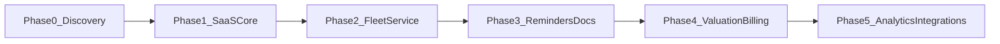
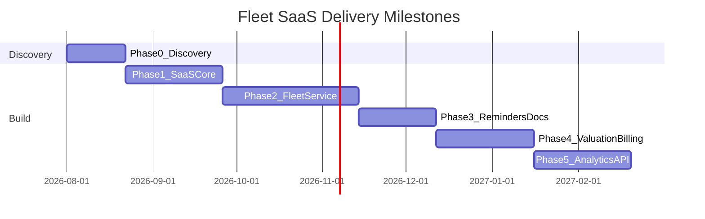

# Phase-Wise Delivery Plan

**Product:** Multi-Tenant SaaS Fleet Maintenance Management System (Odoo)  
**Companion to:** [SRS-Fleet-Maintenance-SaaS.md](./SRS-Fleet-Maintenance-SaaS.md), [Module-Wise-Requirements.md](./Module-Wise-Requirements.md)  
**Version:** 1.0  
**Date:** 31 July 2026  

---

## 1. Purpose

This document defines **how** the system will be delivered in sequenced phases so that:

- The client receives usable value early  
- Technical risk (tenancy, billing) is retired first  
- Estimation and staffing can be planned with clear exit criteria  
- Scope changes are controlled at phase gates  

---

## 2. Phase Overview

| Phase | Name | Primary Outcome | Indicative Duration* |
|-------|------|-----------------|----------------------|
| 0 | Discovery & Design | Signed scope, UX wireframes, estimate | 2–3 weeks |
| 1 | SaaS Core | Multi-tenant signup, plans, users, billing skeleton | 4–6 weeks |
| 2 | Fleet & Service | Vehicles, templates, services, parts | 6–8 weeks |
| 3 | Reminders & Documents | Scheduler, email/in-app, document vault | 3–5 weeks |
| 4 | Valuation & Billing Depth | Depreciation valuation, upgrade/downgrade, SMS/WhatsApp | 4–6 weeks |
| 5 | Analytics & Integrations | Advanced dashboards, public API, AI valuation prep | 4–6 weeks |

\*Indicative for a mid-size Odoo team (2–3 developers + BA/QA). Final estimate after Phase 0.

---

## 3. Governance & Phase Gates

Each phase ends with a **Gate Review**:

1. Demo of in-scope features  
2. UAT sign-off checklist  
3. Security/isolation spot-check (from Phase 1 onward)  
4. Decision: Proceed / Rework / Descope  

**Change control:** New requirements after gate → backlog for later phase or formal change request.

---

## 4. Phase 0 — Discovery & Design

### 4.1 Goals

- Validate SRS with client stakeholders  
- Confirm Odoo Community vs Enterprise  
- Confirm payment gateway, S3, email provider  
- Produce UX wireframes for critical screens  
- Produce effort estimate and commercial proposal  

### 4.2 In Scope

| Item |
|------|
| Requirement workshops (operations, finance, IT) |
| Gap analysis vs standard Odoo modules |
| Information architecture & navigation |
| Wireframes: Login, Dashboard, Vehicle, Service, Admin Plans |
| Non-functional targets agreement |
| Risk register review |

### 4.3 Out of Scope

- Production coding  
- Data migration of legacy fleets (assess only)  

### 4.4 Deliverables

- Workshop minutes  
- Updated SRS (if needed) — version bump  
- Wireframe pack  
- High-level architecture diagram  
- Phase 1–5 estimate & staffing plan  

### 4.5 Exit Criteria

- [ ] Client written approval of SRS v1.x  
- [ ] Odoo edition decided  
- [ ] Payment & infra vendors identified  
- [ ] Commercial SOW signed for Phase 1+  

### 4.6 Dependencies

Client availability; legal/commercial closure.

### 4.7 Effort Band

**S / M** (mostly BA, Architect, Designer).

---

## 5. Phase 1 — SaaS Core

### 5.1 Goals

Establish secure multi-tenant foundation and monetization path.

### 5.2 Modules In Scope

| Module | Depth |
|--------|-------|
| Authentication | Full P0 |
| Subscription Management | Plans, trial, basic subscribe |
| Customer (Tenant) Management | Admin CRUD + statuses |
| Company Profile | Full |
| User Management | Roles + invite + quotas |
| Billing | Invoice + payment gateway happy path |
| Settings | Regional basics |
| Audit Logs | Login, user, subscription events |
| Dashboard | SaaS Admin MVP widgets |

### 5.3 Out of Scope

Vehicles, services, parts, WhatsApp, valuation, advanced reports.

### 5.4 Key User Journeys

1. Self-signup → trial tenant → owner login  
2. SaaS Admin creates plan → assigns to tenant  
3. Owner invites Admin user (quota enforced)  
4. Payment converts trial → Active  

### 5.5 Technical Deliverables

- Dockerized Odoo + PostgreSQL + Redis + Nginx  
- Tenant record rules baseline  
- `saas.plan` / `saas.subscription` models  
- S3 bucket + path conventions  
- CI pipeline (lint/test/deploy staging)  

### 5.6 Exit Criteria

- [ ] Tenant A cannot see Tenant B company/users  
- [ ] Plan quotas block excess users  
- [ ] Trial expiry job works in staging  
- [ ] Payment success activates subscription  
- [ ] Admin dashboard shows tenant counts for seed data  
- [ ] UAT sign-off Phase 1  

### 5.7 Dependencies

Phase 0 gate; payment sandbox credentials.

### 5.8 Effort Band

**L**

---

## 6. Phase 2 — Fleet & Service

### 6.1 Goals

Deliver the operational heart: vehicles, preventive templates, service records, spare parts.

### 6.2 Modules In Scope

| Module | Depth |
|--------|-------|
| Fleet Management | Full MVP |
| Vehicle Management | Full fields + types + custom categories |
| Preventive Maintenance | Templates + next-due computation |
| Service Management | Full record + media uploads |
| Spare Parts | Master + consumption on service |
| Reports | Vehicle + Maintenance + basic Expense |
| Dashboard | Tenant widgets for vehicles/services |
| Audit Logs | Vehicle/service critical events |

### 6.3 Seed Content

- 13 vehicle types  
- Sample Truck (10,000 KM) and Excavator (250 hours) templates  

### 6.4 Out of Scope

Document expiry engine (basic upload OK), SMS/WhatsApp, valuation AI, public API.

### 6.5 Key User Journeys

1. Register vehicle → assign operator → set meters  
2. Apply template → create service from checklist  
3. Consume parts → Done → stock & next due updated  
4. Export maintenance report Excel  

### 6.6 Exit Criteria

- [ ] Custom vehicle category creatable by Admin  
- [ ] Dual meter templates behave correctly  
- [ ] Service Done updates stock and meters  
- [ ] Vehicle quota enforced  
- [ ] Storage usage increases on media upload  
- [ ] Isolation tests pass on vehicle/service models  
- [ ] UAT sign-off Phase 2  

### 6.7 Dependencies

Phase 1 production-ready staging; S3 working.

### 6.8 Effort Band

**XL**

---

## 7. Phase 3 — Reminders & Documents

### 7.1 Goals

Reduce compliance risk via automated reminders and a durable document vault.

### 7.2 Modules In Scope

| Module | Depth |
|--------|-------|
| Documents | Full types, expiry, permanent attach |
| Notifications | In-app + Email; scheduler |
| Preventive Maintenance | Calendar view (P1) |
| Dashboard | Documents Expiring, Notifications widgets |
| Settings | Reminder lead days, channel toggles |
| Reports | Upcoming / Overdue services |

### 7.3 Steps (Within Phase)

| Step | Work Item |
|------|-----------|
| 3.1 | Document metadata model + UI tabs on vehicle |
| 3.2 | Expiry fields on compliance docs |
| 3.3 | Cron: service due scanner |
| 3.4 | Cron: document expiry scanner |
| 3.5 | In-app notification center |
| 3.6 | Email templates + delivery |
| 3.7 | Deduplication & lead-day settings |
| 3.8 | UAT with time-travel/fixture dates |

### 7.4 Out of Scope

SMS, WhatsApp, AI valuation.

### 7.5 Exit Criteria

- [ ] Insurance expiring in 7 days generates in-app + email  
- [ ] Service due generates reminder once per day max  
- [ ] Soft-deleted document retained in audit sense (no hard purge by Mechanic)  
- [ ] Quota blocks upload when storage full  
- [ ] UAT sign-off Phase 3  

### 7.6 Dependencies

Phase 2; SMTP provider.

### 7.7 Effort Band

**M–L**

---

## 8. Phase 4 — Valuation & Billing Depth

### 8.1 Goals

Commercial flexibility (upgrade/downgrade) and first-generation vehicle valuation; expand notification channels.

### 8.2 Modules In Scope

| Module | Depth |
|--------|-------|
| Vehicle Valuation | Basic depreciation method |
| Subscription Management | Upgrade/downgrade, proration |
| Billing | Credit notes, dunning reminders |
| Notifications | SMS + WhatsApp |
| Reports | Vehicle-wise expenses, monthly/annual |
| Dashboard | Revenue quality widgets refinement |

### 8.3 Steps

| Step | Work Item |
|------|-----------|
| 4.1 | Valuation formula service + vehicle UI |
| 4.2 | Accident / major repair flags as inputs |
| 4.3 | Upgrade flow + proration invoice |
| 4.4 | Downgrade eligibility checks vs usage |
| 4.5 | SMS provider integration |
| 4.6 | WhatsApp Business API templates |
| 4.7 | Notification preference matrix |
| 4.8 | UAT finance + operations |

### 8.4 Out of Scope

AI model training; IoT telematics; native mobile apps.

### 8.5 Exit Criteria

- [ ] Valuation returns value when purchase cost + age present  
- [ ] Upgrade increases quotas after payment  
- [ ] Downgrade blocked when vehicles exceed target plan  
- [ ] WhatsApp or SMS message delivered in sandbox  
- [ ] UAT sign-off Phase 4  

### 8.6 Dependencies

Phase 3; WhatsApp business verification (parallel track — may slip to Phase 5 without blocking valuation/billing).

### 8.7 Effort Band

**L**

---

## 9. Phase 5 — Analytics & Integrations

### 9.1 Goals

Make the product integration-ready and analytics-rich; prepare AI valuation.

### 9.2 Modules In Scope

| Module | Depth |
|--------|-------|
| Dashboard | Full SaaS + Tenant polish, click-through |
| Reports | Full catalog + scheduling email reports (optional) |
| API Requirements | Versioned REST + webhooks |
| Vehicle Valuation | AI-assisted design + pilot (if data ready) |
| Settings | API keys, webhook endpoints |
| Audit Logs | Export for compliance |

### 9.3 Steps

| Step | Work Item |
|------|-----------|
| 5.1 | REST API auth (OAuth2/API key) |
| 5.2 | Vehicles/Services/Reminders endpoints |
| 5.3 | Webhooks for subscription & overdue events |
| 5.4 | Advanced dashboard OWL clients |
| 5.5 | AI valuation spike + human override |
| 5.6 | Penetration test & performance test |
| 5.7 | Production HA hardening checklist |
| 5.8 | Final UAT & go-live review |

### 9.4 Exit Criteria

- [ ] External client can list vehicles via API with tenant scope  
- [ ] Webhook delivered on test overdue event  
- [ ] Performance targets met on agreed dataset size  
- [ ] Security test findings closed or accepted  
- [ ] Final acceptance against SRS §19  

### 9.5 Dependencies

Phases 1–4 stable in production or pre-prod; anonymized dataset for AI if pursued.

### 9.6 Effort Band

**L–XL**

---

## 10. Cross-Phase Workstreams

| Workstream | Continuous Activities |
|------------|----------------------|
| Security | Isolation tests in CI from Phase 1 |
| DevOps | Staging parity, backups, monitoring |
| QA | Regression pack grows each phase |
| Documentation | Admin guide + tenant user guide |
| Training | End of Phases 2, 3, 4 |

---

## 11. Milestone Timeline (Example)

Dates are illustrative; replace with SOW dates after Phase 0.

---

## 12. Team Recommendation

| Role | Phase 0 | Phases 1–2 | Phases 3–5 |
|------|---------|------------|------------|
| Product / BA | ✓ | ✓ | Part-time |
| Odoo Technical Lead | ✓ | ✓ | ✓ |
| Odoo Developer | — | 1–2 | 2 |
| Frontend OWL (as needed) | — | 1 | 1 |
| QA Engineer | — | ✓ | ✓ |
| DevOps | Part-time | ✓ | ✓ |
| Designer | ✓ | Part-time | As needed |

---

## 13. Estimation Inputs Checklist

Before final commercial estimate, confirm:

- [ ] Expected tenants Year 1  
- [ ] Peak vehicles per tenant  
- [ ] Average media size per service  
- [ ] Community vs Enterprise Odoo  
- [ ] Payment gateway  
- [ ] Need for data migration  
- [ ] WhatsApp mandatory for go-live?  
- [ ] Languages beyond English  

---

## 14. Phase Acceptance Sign-off Template

| Field | Value |
|-------|-------|
| Phase | |
| Build version / tag | |
| UAT environment URL | |
| Defects open (Critical/High) | 0 / 0 required |
| Isolation test attached | Yes/No |
| Client representative | |
| Signature / Date | |

---

## 15. Summary

Delivery proceeds from **platform trust (tenancy + billing)** to **fleet operations**, then **compliance automation**, then **commercial depth & messaging**, and finally **APIs & advanced analytics**. This sequencing minimizes rework, surfaces multi-tenant risks early, and aligns with how SaaS fleet customers adopt the product.

For functional detail, refer to the [Master SRS](./SRS-Fleet-Maintenance-SaaS.md) and [Module-Wise Requirements](./Module-Wise-Requirements.md).

---

*End of Phase-Wise Delivery Plan — Version 1.0*
