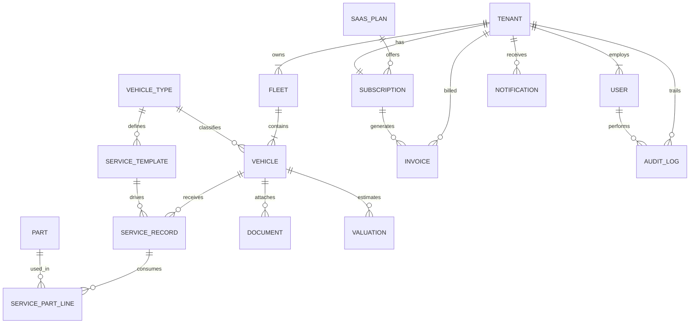
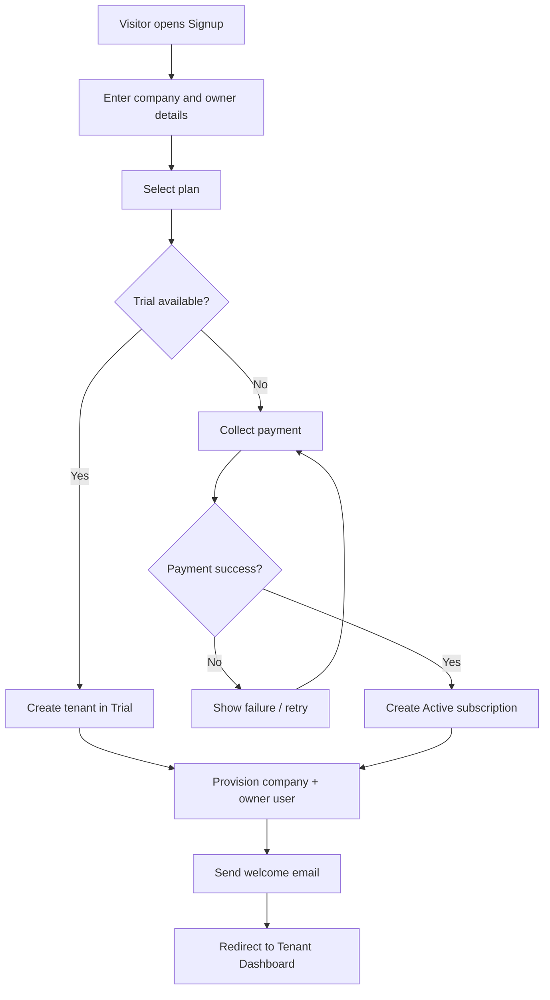
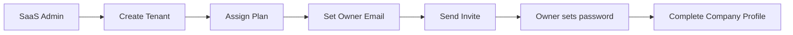
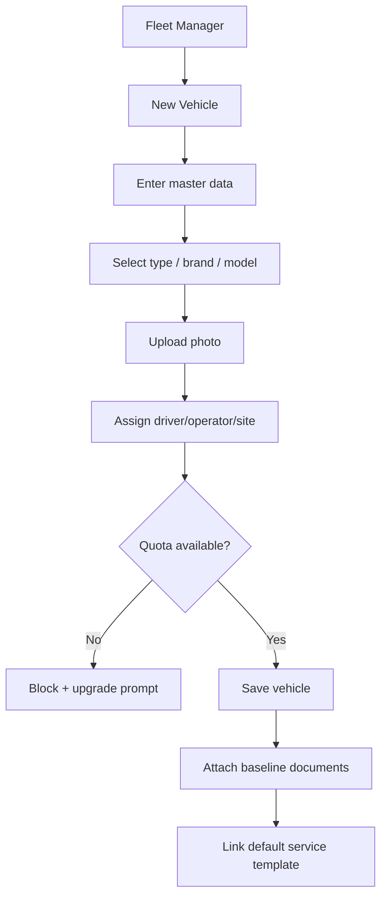
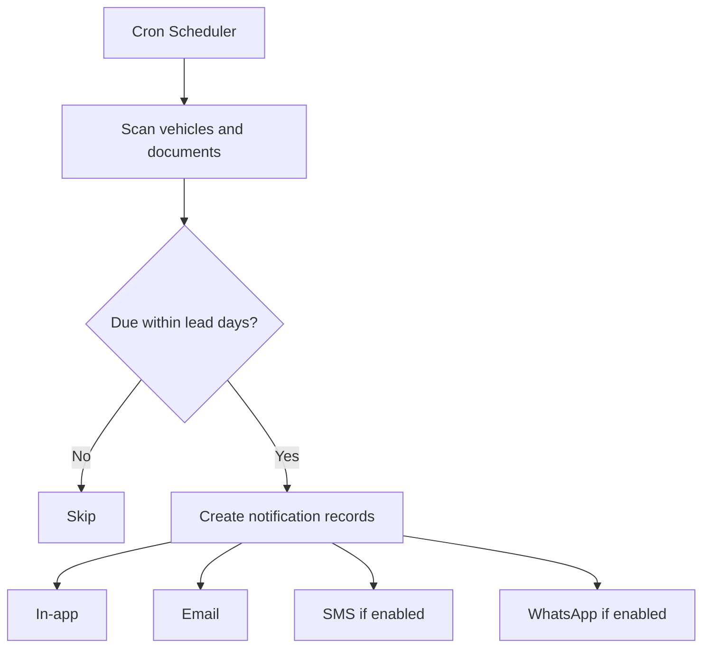
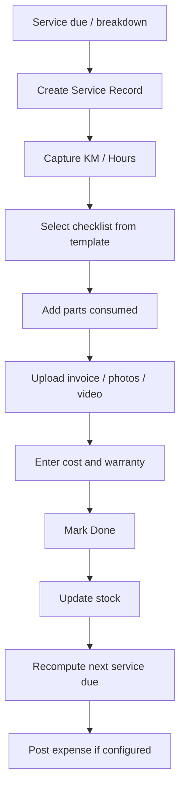
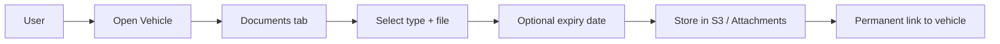
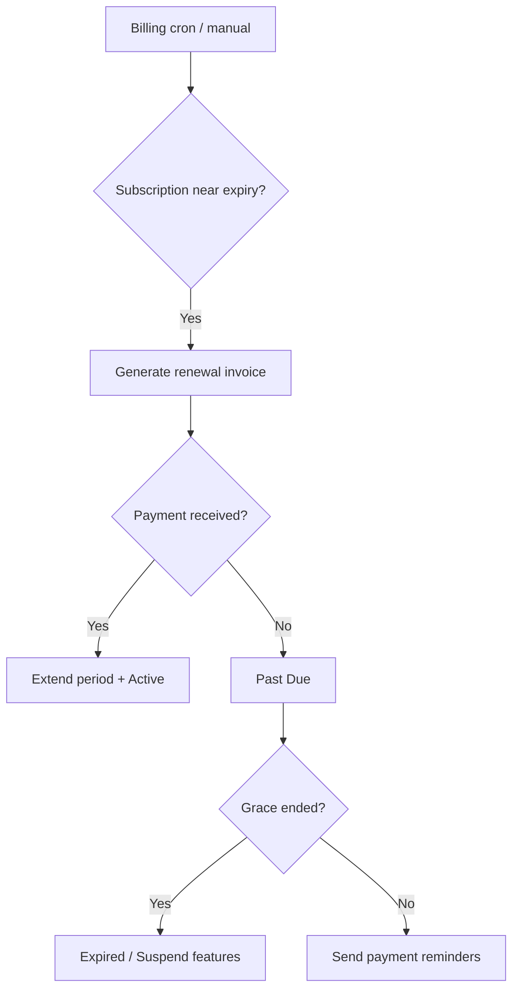

# Software Requirements Specification (SRS)

# Multi-Tenant SaaS Fleet Maintenance Management System

**Built on Odoo**

---

## 1. Cover Page

| Field | Value |
|-------|-------|
| **Document Title** | Software Requirements Specification — Multi-Tenant SaaS Fleet Maintenance Management System |
| **Product Name** | FleetCare SaaS (working title) |
| **Version** | 1.0 |
| **Date** | 31 July 2026 |
| **Status** | Draft for Client Review |
| **Classification** | Confidential |
| **Prepared by** | Business Analysis & Solution Architecture |
| **Reviewed by** | Product Management, SaaS ERP Consultant |
| **Approved by** | _Pending Client Sign-off_ |
| **Platform** | Odoo 17+ / PostgreSQL / Docker |
| **Related Documents** | [Module-Wise Requirements](./Module-Wise-Requirements.md), [Phase-Wise Delivery Plan](./Phase-Wise-Delivery-Plan.md) |

---

## 2. Revision History

| Version | Date | Author | Changes |
|---------|------|--------|---------|
| 0.1 | 2026-07-15 | BA Team | Initial outline |
| 0.5 | 2026-07-25 | BA + Architect | Modules, tenancy, Odoo mapping |
| 1.0 | 2026-07-31 | BA + PM + Architect | Complete SRS for client presentation |

---

## 3. Table of Contents

1. [Cover Page](#1-cover-page)
2. [Revision History](#2-revision-history)
3. [Table of Contents](#3-table-of-contents)
4. [Executive Summary](#4-executive-summary)
5. [Business Requirements](#5-business-requirements)
6. [Functional Requirements](#6-functional-requirements)
7. [User Roles](#7-user-roles)
8. [Module-wise Features](#8-module-wise-features)
9. [Database Design](#9-database-design)
10. [Process Flow Diagrams](#10-process-flow-diagrams)
11. [UI Screen List](#11-ui-screen-list)
12. [API Requirements](#12-api-requirements)
13. [Security Requirements](#13-security-requirements)
14. [Non-Functional Requirements](#14-non-functional-requirements)
15. [Development Phases](#15-development-phases)
16. [Future Enhancements](#16-future-enhancements)
17. [Project Assumptions](#17-project-assumptions)
18. [Risks](#18-risks)
19. [Acceptance Criteria](#19-acceptance-criteria)
20. [Conclusion](#20-conclusion)

---

## 4. Executive Summary

### 4.1 Purpose of the System

The **Multi-Tenant SaaS Fleet Maintenance Management System** is an enterprise-grade cloud application that enables construction, mining, logistics, and heavy-equipment organizations to manage vehicles, preventive maintenance, spare parts, compliance documents, expenses, valuation, and operational reporting from a single platform.

The product is sold by a **SaaS Platform Owner** under subscription plans (Monthly, Quarterly, Yearly, Lifetime). Each paying customer operates as an independent **Tenant (Company)** with complete data isolation.

### 4.2 Business Problem

Fleet-heavy businesses today struggle with:

- Missed service intervals leading to breakdowns and downtime  
- Scattered insurance, permit, fitness, and pollution documents  
- No unified view of maintenance cost per vehicle  
- Manual reminders via spreadsheets or WhatsApp groups  
- Lack of visibility into fleet value and expense trends  
- Multi-site equipment with poorly tracked operators and drivers  

### 4.3 Solution Overview

The system delivers:

| Capability | Business Outcome |
|------------|------------------|
| Vehicle & fleet registry | Single source of truth for every asset |
| Service templates & scheduler | Standardized preventive maintenance |
| Service records with media | Full audit trail of work performed |
| Automated reminders | Reduced compliance and service risk |
| Spare parts inventory | Controlled stock and warranty tracking |
| Document vault | Permanent vehicle-attached compliance files |
| Valuation engine | Informed buy/sell/retain decisions |
| Dashboards & reports | Executive and operational visibility |
| Multi-tenant SaaS billing | Recurring revenue for the platform owner |

### 4.4 Target Market

Construction companies, JCB rental firms, earth movers, excavation contractors, mining companies, logistics operators, and private fleet owners.

### 4.5 Technology Direction

The solution is built on **Odoo 17+** leveraging standard modules (Fleet, Maintenance, Subscriptions, Accounting, Documents, Contacts, CRM, Sales, Mail) extended with custom modules for service templates, maintenance scheduling, vehicle valuation, WhatsApp integration, and fleet dashboards. Deployment uses Docker, Nginx, Redis, PostgreSQL, and object storage (Amazon S3).

### 4.6 Document Scope

This SRS defines business, functional, data, security, and non-functional requirements sufficient for UI/UX design, development estimation, and client acceptance. Detailed module field-level specifications are in [Module-Wise-Requirements.md](./Module-Wise-Requirements.md). Delivery sequencing is in [Phase-Wise-Delivery-Plan.md](./Phase-Wise-Delivery-Plan.md).

---

## 5. Business Requirements

### 5.1 SaaS Business Model

| Stakeholder | Role |
|-------------|------|
| **Platform Owner (SaaS Admin)** | Creates plans, onboards tenants, collects payments, monitors MRR/ARR, supports customers |
| **Tenant (Customer Company)** | Subscribes, manages own fleet, users, services, documents, and expenses |
| **End Users** | Employees of the tenant with role-based access |

### 5.2 Primary Business Objectives

1. Help tenants manage construction vehicles and service schedules.  
2. Maintain complete maintenance history and spare-parts usage.  
3. Automate service and compliance reminders.  
4. Centralize vehicle documents and media.  
5. Track expenses and estimate vehicle valuation.  
6. Provide operational and executive reports/dashboards.  
7. Enforce strict multi-tenant isolation.  
8. Enable the platform owner to monetize via subscriptions.

### 5.3 Tenant Isolation Principle

**No tenant shall ever read, write, or infer another tenant’s data.** Isolation is enforced at database record-rule level, application ACL level, storage path level, and API authentication scope.

### 5.4 Vehicle Types (Seed Catalog)

| Vehicle Type |
|--------------|
| JCB |
| Excavator |
| Truck |
| Tipper |
| Bulldozer |
| Loader |
| Crane |
| Backhoe Loader |
| Road Roller |
| Forklift |
| Trailer |
| Concrete Mixer |
| Water Tanker |

Administrators may create **unlimited custom vehicle categories**.

### 5.5 Subscription Business Rules

| Plan Type | Billing Cycle |
|-----------|---------------|
| Monthly | Every 30 days |
| Quarterly | Every 90 days |
| Yearly | Every 365 days |
| Lifetime | One-time (support renewals may apply separately) |

Each plan configures: Max Users, Max Vehicles, Max Storage, Feature Access flags, Trial Days, Expiry behavior, Invoicing, Payments, Upgrade/Downgrade, and Renewal.

### 5.6 Company Profile Requirements

Every tenant company stores: Company Name, GST Number, Address, Phone, Email, Logo, Subscription Plan, Subscription Status, Owner, Created Date, Storage Usage.

### 5.7 Success Metrics (Business KPIs)

| KPI | Target Direction |
|-----|------------------|
| Tenant activation after trial | Increase |
| Service overdue rate | Decrease |
| Document expiry incidents | Decrease |
| MRR / ARR | Increase |
| Churn | Decrease |
| Average vehicles per tenant | Increase |

---

## 6. Functional Requirements

Requirements are identified as **FR-xxx**. Priority: **P0** (MVP), **P1** (near-term), **P2** (later).

### 6.1 Authentication & Access

| ID | Requirement | Priority |
|----|-------------|----------|
| FR-001 | Users authenticate via email/password with secure session | P0 |
| FR-002 | Support password reset via email | P0 |
| FR-003 | Enforce MFA for SaaS Admin (configurable for tenants) | P1 |
| FR-004 | Lock account after N failed login attempts | P0 |
| FR-005 | Session timeout configurable per security policy | P0 |

### 6.2 Subscription & Billing

| ID | Requirement | Priority |
|----|-------------|----------|
| FR-010 | SaaS Admin creates/edits subscription plans | P0 |
| FR-011 | Plans support Monthly, Quarterly, Yearly, Lifetime | P0 |
| FR-012 | Plans define quotas: users, vehicles, storage | P0 |
| FR-013 | Plans define feature flags | P0 |
| FR-014 | Trial period with configurable days | P0 |
| FR-015 | Automatic invoice generation on subscribe/renew | P0 |
| FR-016 | Record payments and update subscription status | P0 |
| FR-017 | Support plan upgrade with proration rules | P1 |
| FR-018 | Support plan downgrade at next billing cycle | P1 |
| FR-019 | Block or soft-limit features on expiry | P0 |

### 6.3 Tenant & Company

| ID | Requirement | Priority |
|----|-------------|----------|
| FR-020 | Self-service or admin-assisted tenant signup | P0 |
| FR-021 | Create company profile with GST, address, logo | P0 |
| FR-022 | Display subscription status and usage meters | P0 |
| FR-023 | Enforce quotas on user/vehicle/storage creation | P0 |

### 6.4 User Management

| ID | Requirement | Priority |
|----|-------------|----------|
| FR-030 | Tenant owner/admin invites users | P0 |
| FR-031 | Assign roles: Owner, Admin, Fleet Manager, Service Manager, Mechanic, Operator, Driver, Accountant, Viewer | P0 |
| FR-032 | Configurable permission groups beyond defaults | P1 |
| FR-033 | Deactivate users without deleting audit history | P0 |

### 6.5 Fleet & Vehicle

| ID | Requirement | Priority |
|----|-------------|----------|
| FR-040 | CRUD vehicles with full attribute set (see §8.7) | P0 |
| FR-041 | Seed vehicle types + custom categories | P0 |
| FR-042 | Assign driver, operator, current site | P0 |
| FR-043 | Track KM and engine hours | P0 |
| FR-044 | Vehicle status lifecycle (Active, In Service, Idle, Sold, Scrapped) | P0 |
| FR-045 | Vehicle photo upload | P0 |

### 6.6 Service & Maintenance

| ID | Requirement | Priority |
|----|-------------|----------|
| FR-050 | Define service templates by vehicle type (KM or hours based) | P0 |
| FR-051 | Customize template checklist items | P0 |
| FR-052 | Create service records with parts, cost, media, warranty | P0 |
| FR-053 | Link service to mechanic and workshop | P0 |
| FR-054 | Compute next service due from template + meter | P0 |
| FR-055 | Preventive maintenance calendar view | P1 |

### 6.7 Reminders & Notifications

| ID | Requirement | Priority |
|----|-------------|----------|
| FR-060 | Remind for next service due | P0 |
| FR-061 | Remind for insurance/permit/fitness/pollution/warranty expiry | P0 |
| FR-062 | In-app notifications | P0 |
| FR-063 | Email notifications | P0 |
| FR-064 | SMS notifications | P1 |
| FR-065 | WhatsApp notifications | P1 |

### 6.8 Parts, Documents, Valuation

| ID | Requirement | Priority |
|----|-------------|----------|
| FR-070 | Spare parts master with stock, price, supplier, compatibility | P0 |
| FR-071 | Consume parts on service and update stock | P0 |
| FR-072 | Upload documents permanently attached to vehicle | P0 |
| FR-073 | Document types: insurance, registration, invoices, reports, media, certificates | P0 |
| FR-074 | Basic depreciation-based vehicle valuation | P1 |
| FR-075 | AI-based valuation (future) | P2 |

### 6.9 Reports & Dashboards

| ID | Requirement | Priority |
|----|-------------|----------|
| FR-080 | Vehicle, maintenance, expense, upcoming/overdue reports | P0 |
| FR-081 | PDF and Excel export | P0 |
| FR-082 | Tenant operational dashboard widgets | P0 |
| FR-083 | SaaS Admin dashboard (customers, MRR, ARR, storage) | P0 |

### 6.10 Settings, Audit, Platform

| ID | Requirement | Priority |
|----|-------------|----------|
| FR-090 | Tenant settings (timezone, currency, notification prefs) | P0 |
| FR-091 | Immutable audit log of critical actions | P0 |
| FR-092 | Platform admin tenant management & support tickets view | P1 |

---

## 7. User Roles

### 7.1 Platform Roles

| Role | Scope | Description |
|------|-------|-------------|
| SaaS Super Admin | Platform | Full control of plans, tenants, billing, configuration |
| SaaS Support | Platform | Read tenant metadata, manage tickets, no tenant operational data by default |
| SaaS Finance | Platform | Invoices, payments, revenue reports |

### 7.2 Tenant Roles

| Role | Description |
|------|-------------|
| Owner | Full tenant control including billing and user management |
| Admin | Operational admin; may be restricted from billing |
| Fleet Manager | Vehicles, assignments, fleet reports |
| Service Manager | Templates, schedules, service approvals |
| Mechanic | Execute and update service records |
| Operator | View assigned vehicles; update hours/KM (limited) |
| Driver | View assigned vehicles; limited updates |
| Accountant | Expenses, invoices, financial reports |
| Viewer | Read-only dashboards and reports |

### 7.3 Permission Matrix (Summary)

| Capability | Owner | Admin | Fleet Mgr | Service Mgr | Mechanic | Operator | Driver | Accountant | Viewer |
|------------|:-----:|:-----:|:---------:|:-----------:|:--------:|:--------:|:------:|:----------:|:------:|
| Manage subscription | ✓ | — | — | — | — | — | — | — | — |
| Manage users | ✓ | ✓ | — | — | — | — | — | — | — |
| Manage vehicles | ✓ | ✓ | ✓ | R | R | R* | R* | R | R |
| Service templates | ✓ | ✓ | R | ✓ | R | — | — | — | R |
| Create service | ✓ | ✓ | ✓ | ✓ | ✓ | — | — | — | — |
| Parts stock | ✓ | ✓ | R | ✓ | R | — | — | ✓ | R |
| Documents | ✓ | ✓ | ✓ | ✓ | ✓ | R | R | R | R |
| Expenses | ✓ | ✓ | R | R | — | — | — | ✓ | R |
| Valuation | ✓ | ✓ | ✓ | R | — | — | — | ✓ | R |
| Reports export | ✓ | ✓ | ✓ | ✓ | R | — | — | ✓ | R |
| Settings | ✓ | ✓ | — | — | — | — | — | — | — |
| Audit logs | ✓ | ✓ | — | — | — | — | — | — | — |

*R = Read; R\* = read assigned vehicles only; ✓ = full; — = none.*

Configurable ACL groups allow refinement without code changes.

---

## 8. Module-wise Features

> Full field-level detail: [Module-Wise-Requirements.md](./Module-Wise-Requirements.md)

### 8.1 Authentication

Secure login, logout, password reset, session control, optional MFA, tenant-aware identity.

### 8.2 Subscription Management

Plan catalog, quotas, feature flags, trials, expiry, renewals, upgrade/downgrade.

### 8.3 Customer (Tenant) Management

Platform-side tenant lifecycle: create, activate, suspend, expire, reactivate; usage monitoring.

### 8.4 Company Profile

Tenant self-service company master data and branding (logo).

### 8.5 User Management

Invite, role assignment, deactivate, permission groups.

### 8.6 Fleet Management

Logical grouping of vehicles (sites, fleets, cost centers).

### 8.7 Vehicle Management

**Fields:** Vehicle Number, Name, Type, Brand, Model, Year, Purchase Date, Purchase Cost, Current KM, Current Engine Hours, Fuel Type, Insurance, Permit, Fitness, Pollution, Engine Number, Chassis Number, Photo, Status, Assigned Driver, Assigned Operator, Current Site.

### 8.8 Service Management

Service orders/records with mechanic, workshop, invoice, media, parts, cost, warranty, duration, status.

### 8.9 Preventive Maintenance

Templates (e.g., Truck every 10,000 KM; Excavator every 250 engine hours) with checklist tasks; scheduler computes next due.

### 8.10 Documents

Permanent attachment of insurance, registration, invoices, reports, photos, videos, warranties, permits, fitness & pollution certificates to the vehicle.

### 8.11 Reports

Vehicle, maintenance, expense, upcoming/overdue, vehicle-wise expenses, monthly/annual; PDF/Excel export.

### 8.12 Dashboard

**Tenant widgets:** Total Vehicles, In Service, Upcoming, Overdue, Total Expenses, Today’s Services, Monthly Expenses, Notifications, Recent Activity, Documents Expiring.

**SaaS Admin widgets:** Total/Active/Trial/Expired Customers, Revenue, MRR, ARR, Active Users, Subscriptions, Payments, Storage Usage, Support Tickets.

### 8.13 Notifications

Channels: In-app, Email (P0); SMS, WhatsApp (P1). Events: service due, document expiry, subscription expiry, payment failure.

### 8.14 Billing

Invoices, payment recording, dunning (soft), receipt history, tax fields (GST).

### 8.15 Settings

Timezone, currency, units (KM/miles), reminder lead days, notification toggles, numbering sequences.

### 8.16 Audit Logs

Who/what/when/where for create/update/delete on critical models; immutable retention policy.

### 8.17 Odoo Module Mapping

| Standard Odoo | Usage |
|---------------|--------|
| Fleet | Base vehicle assets (extended) |
| Maintenance | Work orders foundation (extended) |
| Subscriptions | SaaS plans & recurring billing |
| Accounting | Invoices, payments, expenses |
| Documents | File vault |
| Contacts | Partners, workshops, suppliers |
| CRM / Sales | Optional lead-to-subscription |
| Email / Activities | Reminders & tasks |

| Custom Module | Purpose |
|---------------|---------|
| Fleet Service Management | Service records, parts consumption |
| Service Templates | KM/hours templates & checklists |
| Maintenance Scheduler | Due computation & jobs |
| Vehicle Valuation | Depreciation & future AI |
| WhatsApp Integration | Outbound reminders |
| Fleet Dashboard | Tenant + SaaS KPI boards |

---

## 9. Database Design

### 9.1 Entity Relationship Overview

### 9.2 Core Tables (Logical Schema)

#### Company / Tenant — `saas_tenant` / `res_company` extension

| Column | Type | Notes |
|--------|------|-------|
| id | PK | |
| name | varchar | Company Name |
| gst_number | varchar | |
| address | text | |
| phone | varchar | |
| email | varchar | |
| logo | binary/S3 ref | |
| plan_id | FK → saas_plan | |
| subscription_status | enum | trial/active/past_due/expired/suspended |
| owner_user_id | FK → res_users | |
| created_at | timestamp | |
| storage_used_bytes | bigint | |

#### Users — `res_users` + membership

| Column | Type | Notes |
|--------|------|-------|
| id | PK | |
| tenant_id | FK | Mandatory for tenant users |
| role_code | varchar | |
| active | boolean | |

#### Vehicle Types — `fleet_vehicle_type`

| Column | Type | Notes |
|--------|------|-------|
| id | PK | |
| tenant_id | FK nullable | null = global seed |
| name | varchar | |
| meter_basis | enum | km / engine_hours / both |

#### Vehicles — `fleet_vehicle` (extended)

| Column | Type | Notes |
|--------|------|-------|
| id | PK | |
| tenant_id | FK | Isolation key |
| vehicle_number | varchar | Unique per tenant |
| name | varchar | |
| type_id | FK | |
| brand, model, year | | |
| purchase_date, purchase_cost | | |
| current_km, current_engine_hours | numeric | |
| fuel_type | varchar | |
| insurance_expiry, permit_expiry, fitness_expiry, pollution_expiry | date | |
| engine_number, chassis_number | varchar | |
| photo | attachment | |
| status | enum | |
| driver_id, operator_id | FK users/contacts | |
| current_site | varchar/FK | |

#### Service Templates — `fleet_service_template`

| Column | Type | Notes |
|--------|------|-------|
| id | PK | |
| tenant_id | FK | |
| vehicle_type_id | FK | |
| interval_km | numeric | nullable |
| interval_hours | numeric | nullable |
| name | varchar | |
| active | boolean | |

#### Template Lines — `fleet_service_template_line`

| Column | Type | Notes |
|--------|------|-------|
| id | PK | |
| template_id | FK | |
| task_name | varchar | e.g. Replace Engine Oil |
| sequence | int | |

#### Service Records — `fleet_service_record`

| Column | Type | Notes |
|--------|------|-------|
| id | PK | |
| tenant_id | FK | |
| vehicle_id | FK | |
| service_date | date | |
| odometer_km, engine_hours | numeric | |
| mechanic_id, workshop_id | FK | |
| invoice_number | varchar | |
| cost | monetary | |
| remarks | text | |
| warranty_until | date | |
| duration_hours | numeric | |
| status | enum | draft/done/cancelled |
| template_id | FK nullable | |

#### Parts — `fleet_part`

| Column | Type | Notes |
|--------|------|-------|
| id | PK | |
| tenant_id | FK | |
| name, brand, category | | |
| qty_on_hand | numeric | |
| unit_price | monetary | |
| warranty_months | int | |
| supplier_id | FK | |

#### Documents — `fleet_vehicle_document`

| Column | Type | Notes |
|--------|------|-------|
| id | PK | |
| tenant_id | FK | |
| vehicle_id | FK | |
| doc_type | enum | |
| file_ref | S3/attachment | |
| expiry_date | date nullable | |
| uploaded_by | FK | |
| uploaded_at | timestamp | |

#### Subscriptions / Invoices / Notifications / Audit

- `saas_plan` — quotas & features  
- `saas_subscription` — tenant ↔ plan, dates, status  
- `account_move` (Odoo) — invoices  
- `fleet_notification` — channel, payload, status  
- `fleet_audit_log` — actor, model, res_id, action, diff, timestamp, tenant_id  

### 9.3 Indexing & Isolation

- Mandatory `tenant_id` (or `company_id`) on all tenant business tables  
- Unique constraints scoped by tenant (e.g., `vehicle_number`)  
- Composite indexes on `(tenant_id, status)`, `(tenant_id, expiry_date)` for reminder jobs  

---

## 10. Process Flow Diagrams

### 10.1 Signup & Subscription

### 10.2 Company Creation (Admin-assisted)

### 10.3 Vehicle Registration

### 10.4 Service Reminder

### 10.5 Vehicle Service

### 10.6 Upload Documents

### 10.7 Renew Subscription

---

## 11. UI Screen List

### 11.1 SaaS Admin Console

| Screen ID | Screen Name |
|-----------|-------------|
| SA-01 | Admin Login |
| SA-02 | Platform Dashboard |
| SA-03 | Plans List / Form |
| SA-04 | Tenants List / Form |
| SA-05 | Subscriptions |
| SA-06 | Invoices & Payments |
| SA-07 | Revenue Reports (MRR/ARR) |
| SA-08 | Storage Usage |
| SA-09 | Support Tickets |
| SA-10 | Platform Settings |
| SA-11 | Audit Logs (platform) |

### 11.2 Tenant Application

| Screen ID | Screen Name |
|-----------|-------------|
| TN-01 | Login / Reset Password |
| TN-02 | Tenant Dashboard |
| TN-03 | Company Profile |
| TN-04 | Users & Roles |
| TN-05 | Fleets |
| TN-06 | Vehicles List / Kanban |
| TN-07 | Vehicle Form (tabs: Info, Service, Docs, Parts, Valuation) |
| TN-08 | Vehicle Types |
| TN-09 | Service Templates |
| TN-10 | Service Records |
| TN-11 | Preventive Calendar |
| TN-12 | Parts Inventory |
| TN-13 | Documents Browser |
| TN-14 | Notifications Center |
| TN-15 | Reports Hub |
| TN-16 | Expenses |
| TN-17 | Subscription & Billing |
| TN-18 | Settings |
| TN-19 | Audit Logs |
| TN-20 | Valuation Detail |

All screens must be **mobile responsive**.

---

## 12. API Requirements

### 12.1 Style

- REST JSON APIs over HTTPS  
- OAuth2 / API key for integrations (P1)  
- Tenant scope embedded in token claims  

### 12.2 Representative Endpoints

| Method | Endpoint | Description |
|--------|----------|-------------|
| POST | `/api/v1/auth/login` | Authenticate |
| GET | `/api/v1/vehicles` | List vehicles (tenant-scoped) |
| POST | `/api/v1/vehicles` | Create vehicle |
| GET | `/api/v1/vehicles/{id}` | Vehicle detail |
| POST | `/api/v1/services` | Create service record |
| GET | `/api/v1/reminders` | Due reminders |
| POST | `/api/v1/documents` | Upload metadata + signed URL |
| GET | `/api/v1/reports/maintenance` | Maintenance report data |
| GET | `/api/v1/subscription` | Current plan & usage |

### 12.3 Webhooks (P1)

- `subscription.expired`  
- `payment.succeeded`  
- `service.overdue`  
- `document.expiring`  

### 12.4 External Integrations

| Integration | Purpose | Phase |
|-------------|---------|-------|
| SMTP / Email gateway | Notifications | P0 |
| SMS gateway | Reminders | P1 |
| WhatsApp Business API | Reminders | P1 |
| Payment gateway | Subscriptions | P0 |
| Amazon S3 | Media & documents | P0 |

---

## 13. Security Requirements

### 13.1 Multi-Tenancy Security

| Control | Description |
|---------|-------------|
| Record rules | Every business model filtered by tenant/company |
| ACL | Role-based access on models and fields |
| Storage isolation | S3 key prefix per tenant |
| API scope | Token cannot cross tenants |
| Admin break-glass | Audited, time-limited support access only |

### 13.2 Application Security

- Password hashing (Odoo standard / PBKDF2)  
- HTTPS only (TLS 1.2+)  
- CSRF protection on web forms  
- Input validation & SQL injection prevention (ORM)  
- File upload type/size scanning  
- Secrets in environment / vault — never in code  

### 13.3 Data Protection

- Encryption in transit; encryption at rest for DB volumes and S3  
- PII minimization in logs  
- Configurable data retention & export for tenant offboarding  

### 13.4 Audit

Critical actions logged: login failures, user role changes, subscription changes, vehicle delete, document delete, payment updates.

---

## 14. Non-Functional Requirements

| Area | Requirement |
|------|-------------|
| **Performance** | List screens p95 &lt; 2s for 10k vehicles/tenant under normal load |
| **Scalability** | Horizontal app workers; Redis queue for jobs; DB read replicas optional |
| **Availability** | Target 99.5% monthly (MVP); 99.9% later with HA |
| **Backup** | Daily automated DB backups; 30-day retention; quarterly restore drill |
| **Logging** | Structured app logs; central aggregation |
| **Monitoring** | Uptime, error rate, queue lag, disk/S3 usage alerts |
| **Multi-language** | English MVP; i18n-ready (Odoo translations) |
| **Mobile** | Responsive web; PWA optional later |
| **API Ready** | Versioned REST from Phase 2 onward |
| **Concurrency** | Safe updates to KM/hours and stock with optimistic/pessimistic locks as needed |

---

## 15. Development Phases

> Detailed plan: [Phase-Wise-Delivery-Plan.md](./Phase-Wise-Delivery-Plan.md)

| Phase | Name | Focus |
|-------|------|-------|
| 0 | Discovery & Design | Workshops, UX wireframes, estimation sign-off |
| 1 | SaaS Core | Auth, tenants, plans, billing, company, users |
| 2 | Fleet & Service | Vehicles, templates, service records, parts |
| 3 | Reminders & Documents | Scheduler, email/in-app, document vault |
| 4 | Valuation & Billing Depth | Depreciation valuation, upgrades/downgrades, SMS/WhatsApp |
| 5 | Analytics & Integrations | Advanced dashboards, APIs, AI valuation prep |

---

## 16. Future Enhancements

1. **AI-based vehicle valuation** using historical market and maintenance patterns  
2. **IoT / telematics** integration for live KM and engine hours  
3. **Mobile native apps** for mechanics and drivers  
4. **Geofencing & site productivity** analytics  
5. **Marketplace** for spare parts suppliers  
6. **Predictive maintenance** ML models  
7. **Multi-country tax packs** beyond GST  
8. **Customer portal** for rental clients of the tenant  

---

## 17. Project Assumptions

1. Client provides branding, GST treatment rules, and payment gateway credentials.  
2. Odoo 17+ is the approved platform; Community vs Enterprise license decision is confirmed before Phase 1.  
3. Tenants accept shared-database isolation (not separate DB per tenant in MVP).  
4. English is the primary language for MVP UI and documentation.  
5. WhatsApp Business API approval timelines are outside delivery control.  
6. Seed vehicle types and sample templates are acceptable defaults for demos.  
7. Media files are stored on S3-compatible object storage.  
8. Client UAT resources are available at the end of each phase.  

---

## 18. Risks

| ID | Risk | Impact | Likelihood | Mitigation |
|----|------|--------|------------|------------|
| R1 | Tenant data leakage | Critical | Low | Record rules tests, security review, penetration test |
| R2 | Scope creep on custom workflows | High | Medium | Phase gates; change control |
| R3 | Payment gateway delays | High | Medium | Sandbox early; manual payment fallback |
| R4 | WhatsApp API approval delay | Medium | High | Ship email/SMS first |
| R5 | Performance with large media | Medium | Medium | S3, CDN, async uploads |
| R6 | Odoo upgrade breaking custom modules | Medium | Medium | Thin customizations; regression suite |
| R7 | Unclear GST/invoicing rules | Medium | Medium | Finance workshop in Phase 0 |
| R8 | Low trial-to-paid conversion | High | Medium | Onboarding UX + template library |

---

## 19. Acceptance Criteria

### 19.1 Global

1. A user of Tenant A cannot access any record of Tenant B via UI or API.  
2. Creating users/vehicles beyond plan quotas is blocked with a clear upgrade message.  
3. Service templates correctly schedule next due by KM and/or engine hours.  
4. Document expiry and service due generate in-app + email notifications within configured lead time.  
5. Service completion updates parts stock and vehicle meters.  
6. PDF and Excel exports generate for standard reports.  
7. SaaS Admin dashboard shows accurate tenant counts and MRR for test data.  
8. Audit log captures role changes and vehicle deletions.  
9. System remains usable on mobile viewport for core flows.  
10. Phase exit criteria in the Phase-Wise plan are signed off by the client.

### 19.2 UAT Evidence

- Test scripts per phase  
- Security checklist (isolation)  
- Backup restore proof  
- Performance spot-check on seeded volume  

---

## 20. Conclusion

This Software Requirements Specification defines a complete, client-ready blueprint for a **Multi-Tenant SaaS Fleet Maintenance Management System on Odoo**. It covers the commercial subscription model, strict tenant isolation, fleet and service operations, compliance documents, reminders, valuation direction, reporting, security, and phased delivery.

Together with the [Module-Wise Requirements](./Module-Wise-Requirements.md) and [Phase-Wise Delivery Plan](./Phase-Wise-Delivery-Plan.md), this pack is sufficient to commence UI/UX design, technical design, estimation, and contractual scoping.

**Next step:** Client workshop to validate priorities, confirm Odoo edition, payment gateway, and Phase 1 kickoff after written approval of Version 1.0.

---

*End of Software Requirements Specification — Version 1.0*
